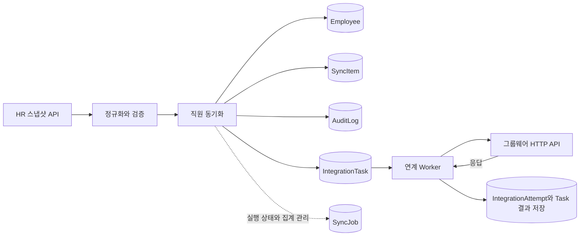
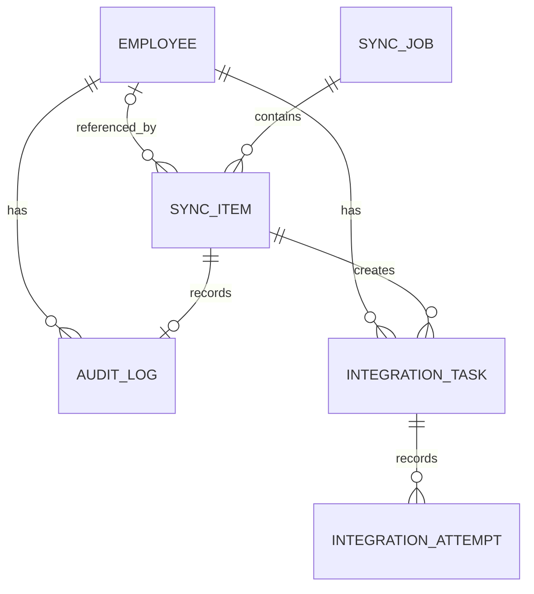
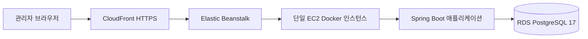

# Employee Lifecycle Sync

HR 직원 스냅샷을 내부 직원 데이터와 동기화하고, 입사·정보 변경·퇴사에 따른 그룹웨어 계정 작업과 외부 연계 실패 이력을 관리합니다.

[](https://github.com/kimsooin77/Sync/actions/workflows/ci.yml?query=branch%3Amain) · [배포 데모](https://d2cpqpf162fsls.cloudfront.net) · [Health](https://d2cpqpf162fsls.cloudfront.net/actuator/health)

## 프로젝트 개요

직원 정보를 여러 시스템에 반영할 때 외부 연계 장애가 내부 직원 처리까지 되돌리거나 다른 직원의 처리를 막으면 업무 복구가 어려워집니다. 이 시스템은 직원 변경을 먼저 내부 DB에 기록하고 외부 계정 반영을 별도 작업으로 처리해, 실패한 연계를 추적하고 다시 실행할 수 있도록 구성했습니다.

## 주요 기능

- HR 직원 스냅샷을 정규화하고 사번 기준으로 `INSERT`·`UPDATE`·`SKIP` 처리
- 직원 변경, 감사 기록, 그룹웨어 연계 작업을 직원 단위로 원자적으로 저장
- 그룹웨어 계정 생성·수정·비활성화와 실제 호출 결과 이력 관리
- 자동 Retry, 허용된 작업의 수동 Retry, 처리 중단 작업 복구
- UUID 멱등 키로 같은 연계 요청의 중복 적용 방지

## 전체 처리 흐름



SyncJob은 동기화 실행 상태와 처리 건수를 관리합니다. 현재 데모에서는 HR과 Groupware의 외부 API 계약과 장애 상황을 Mock HTTP API로 재현합니다.

## 기술 스택

| 구분 | 기술 |
|---|---|
| Backend | Java 21, Spring Boot 4.1.1, Spring Data JPA, Spring Security, Bean Validation, RestClient |
| Frontend | React 19, TypeScript, Vite |
| Database | PostgreSQL 17, Flyway |
| Test | JUnit, Mockito, Testcontainers |
| Infrastructure | Docker, AWS CloudFront, Elastic Beanstalk, RDS, GitHub Actions OIDC |

## 동기화 처리

HR의 한 행은 직원의 현재 전체 상태를 나타내는 스냅샷입니다. 사번, 이름, 이메일, 부서 코드, 재직 상태를 비교합니다. 빈 이메일이나 부서 코드는 `null`로 정규화해 기존 값도 해제합니다.

| 결과 | 기준 | 저장 결과 |
|---|---|---|
| `INSERT` | 사번이 기존 Employee에 없음 | Employee, SyncItem, 생성 AuditLog, IntegrationTask |
| `UPDATE` | 비교 필드 중 값이 달라짐 | Employee, SyncItem, 변경 AuditLog, IntegrationTask |
| `SKIP` | 비교 필드가 모두 같음 | SyncItem |
| `FAILED` | 정규화 검증 또는 직원별 저장 실패 | 실패 SyncItem; 다른 행은 계속 처리 |

최종 재직 상태가 `TERMINATED`이면 신규·변경 여부와 관계없이 `DISABLE_ACCOUNT` 작업을 만듭니다. `ACTIVE` 또는 `ON_LEAVE`의 신규 직원은 `CREATE_ACCOUNT`, 기존 직원 변경은 `UPDATE_ACCOUNT`로 처리합니다. `SKIP`에는 외부 작업을 만들지 않습니다.

## 트랜잭션 설계

```text
SyncJob RUNNING 저장       REQUIRES_NEW → COMMIT
HR HTTP 호출               트랜잭션 없음
전체 건수 반영             REQUIRES_NEW → COMMIT
직원별 Employee 처리       각각 REQUIRES_NEW
  Employee + SyncItem + AuditLog + IntegrationTask
Worker PROCESSING 반영     REQUIRES_NEW → COMMIT
Groupware HTTP 호출        트랜잭션 없음
Attempt + Task 결과 반영   REQUIRES_NEW → COMMIT
```

외부 응답을 기다리는 동안 DB 트랜잭션을 열어 두지 않습니다. INSERT/UPDATE 처리에서 Employee, SyncItem, AuditLog, IntegrationTask 중 하나라도 저장에 실패하면 해당 직원 변경 전체를 롤백합니다. 직원 한 행의 검증·저장 오류는 그 행에 격리합니다.

## 외부 연계 실패 복구

HTTP `429`, `500`, `502`, `503`, `504`, 연결 실패와 timeout은 자동 Retry 대상입니다. 재시도 간격은 5초, 15초, 30초이며 자동 재실행 예산을 소진하면 작업은 `FAILED`로 남습니다. 관리자는 허용된 실패 작업을 수동으로 다시 대기 상태로 전환할 수 있습니다.

`PROCESSING` 상태로 60초 이상 남은 작업은 자동 복구 대상입니다. 재실행 예산이 남으면 다시 처리하고, 소진하면 외부 결과를 확인할 수 없는 상태로 종료합니다. HTTP 호출 결과와 Task 상태는 함께 저장하며, IntegrationAttempt는 결과까지 확인해 영속화한 호출 이력을 나타냅니다.

작업별 UUID 멱등 키는 자동·수동 Retry에서도 유지됩니다. Mock Groupware가 성공 처리했지만 응답이 유실된 경우 같은 키로 다시 요청해 중복 적용을 막고, 같은 키에 다른 요청이 오면 충돌로 처리합니다. 이 멱등 보장은 현재 Mock 구현 범위입니다.

## 성능 개선

직원별 `findByEmployeeNo()` 조회를 employeeNo 최대 1,000개 단위 일괄 조회로 바꾸고, 결과를 Map으로 구성해 비교합니다. INSERT/UPDATE 후보는 직원 단위 트랜잭션에서 최신 Employee를 다시 조회합니다.

| 처리 데이터 | 직원 조회 횟수 (개별 / 일괄) | 처리 시간 |
|---|---:|---:|
| 10,000건 전체 SKIP | 개별 10,000회 → 일괄 10회 | 27.17초 → 18.33초 (32.53% 단축) |
| 1,000 UPDATE + 9,000 SKIP | 개별 10,000회 → 일괄 10회 + 개별 1,000회 | 29.77초 → 21.99초 (26.14% 단축) |

측정 환경은 Java 21.0.6, PostgreSQL 17.11 Testcontainers이며 시간은 각 처리 데이터별 3회 측정의 중앙값입니다. 측정 조건과 전체 PreparedStatement 수는 [직원 일괄 조회 성능 비교](docs/performance/employee-bulk-lookup-performance.md)를 참고하세요.

## 데이터 모델



실패한 SyncItem은 Employee와 연결되지 않을 수 있습니다. AuditLog와 IntegrationTask는 SyncItem을 통해 SyncJob 처리 결과와 연결됩니다.

## 관리자 기능

- HR 동기화 실행 및 SyncJob 결과 확인
- 직원 상세와 변경 감사 이력 조회
- IntegrationTask, payload, Attempt 이력 조회
- 허용된 실패 작업 수동 Retry
- 데모 HR 시나리오와 Groupware 장애 모드 설정

## 배포 구조



React 정적 파일은 Spring Boot JAR에 포함되며, 단일 Elastic Beanstalk Docker 인스턴스에서 애플리케이션과 연계 Worker가 함께 실행됩니다. 애플리케이션과 RDS는 별도 리소스로 구성해 애플리케이션 배포와 DB 생명주기를 분리했습니다. 스키마 변경은 Flyway가 관리합니다.

## CI/CD

`local`과 `develop`에서는 GitHub Actions가 테스트와 build를 검증합니다. `main`은 같은 검증을 통과한 뒤 GitHub Actions OIDC로 AWS에 인증하고 기존 Elastic Beanstalk 환경에 배포합니다. 검증 job이 만든 bundle을 artifact로 전달하고 SHA-256을 확인해 검증한 파일과 배포 파일을 일치시킵니다.

## 로컬 실행

Docker와 `.env.example`에 맞는 로컬 설정이 필요합니다. 저장소 루트에서 실행합니다.

```shell
docker compose up --build
```

## 문서

- [직원 일괄 조회 성능 비교](docs/performance/employee-bulk-lookup-performance.md)
- [AWS 배포 구성](docs/deployment.md)
