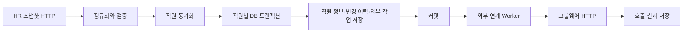
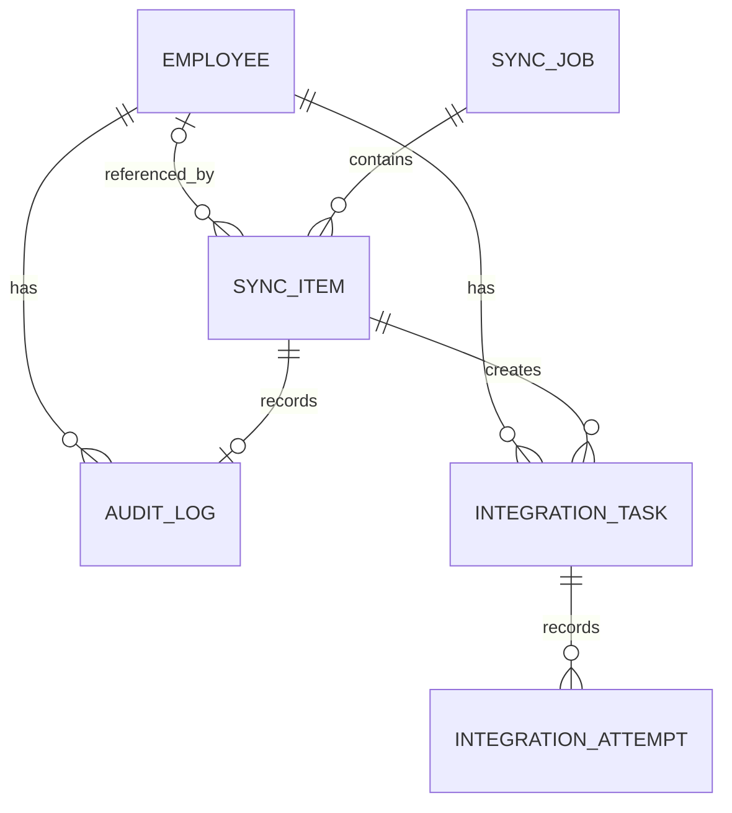
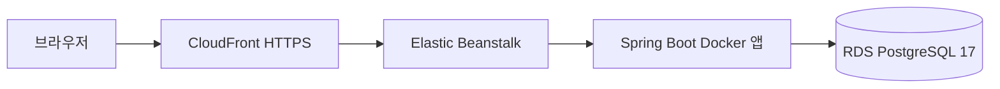

# Employee Lifecycle Sync

HR 직원 스냅샷을 내부 직원 데이터와 동기화하고, 입사·정보 변경·퇴사에 따른 그룹웨어 계정 작업과 외부 연계 실패 이력을 관리합니다.

## 프로젝트 개요

직원 정보 변경을 먼저 내부 데이터베이스에 저장하고, 그룹웨어 반영은 별도 작업으로 처리합니다. 한 직원의 외부 연계가 실패해도 다른 직원의 동기화는 계속되며, 실패 내역을 확인하고 다시 처리할 수 있습니다.

## 핵심 설계

- **외부 장애 격리**: 직원 정보, 변경 이력, 외부 연계 작업을 직원 단위 데이터베이스 트랜잭션으로 저장합니다. 그룹웨어 HTTP 요청은 커밋 후 별도 Worker가 보내므로 외부 응답 지연이 직원 동기화 트랜잭션을 붙잡지 않습니다.
- **실패 작업 복구**: 일시적인 연결·응답 오류는 정해진 간격으로 자동 재처리하고, 최대 재처리 횟수에 도달한 작업은 실패 작업으로 남깁니다. 처리 중단 작업도 감지해 재처리하거나 관리자가 다시 요청할 수 있습니다.
- **반복 동기화 조회 개선**: 사번을 묶음으로 조회해 메모리에서 비교하므로 변경이 없는 직원의 개별 조회를 줄입니다. 실제 처리 시간과 조회 횟수는 아래 성능 개선에 기록했습니다.

## 전체 처리 흐름

직원 정보와 변경 이력, 외부 연계 작업을 먼저 저장한 뒤 그룹웨어를 호출합니다. 외부 응답을 기다리는 동안 DB 트랜잭션을 유지하지 않습니다.

## 기술 스택

- Java 21, Spring Boot 4.1.1, Spring Data JPA, Spring Security
- PostgreSQL 17, Flyway
- React 19, TypeScript
- JUnit, Testcontainers, Docker
- AWS CloudFront, Elastic Beanstalk, RDS, GitHub Actions OIDC

## 직원 동기화 기준

HR 데이터는 직원의 현재 전체 상태를 나타내는 스냅샷입니다. 사번, 이름, 회사 이메일, 부서 코드, 재직 상태를 비교하며, 이메일이나 부서가 비어 있으면 기존 값도 비워 미배정 상태로 반영합니다. 각 행은 독립적으로 처리합니다.

| 결과 | 기준 | 저장 결과 |
|---|---|---|
| 신규 (`INSERT`) | 기존 사번이 없음 | 직원 정보, 변경 이력, 외부 연계 작업 저장 |
| 변경 (`UPDATE`) | 비교 항목의 값이 달라짐 | 직원 정보 갱신, 변경 이력, 외부 연계 작업 저장 |
| 변경 없음 (`SKIP`) | 비교 항목이 모두 같음 | 처리 결과 저장 |
| 실패 (`FAILED`) | 정규화·검증 또는 해당 직원 저장 실패 | 실패 결과 저장 후 다음 행 처리 |

직원 정보 변경, 변경 이력, 외부 연계 작업은 한 직원의 트랜잭션에 함께 저장합니다. 퇴사자는 그룹웨어 계정을 비활성화하고, 재직 또는 휴직 상태의 신규 직원은 계정을 만듭니다. 기존 직원 정보가 바뀌면 계정을 갱신하며, 변경이 없으면 외부 작업을 만들지 않습니다.

## 외부 연계 실패 대응

- **자동 재처리**: 연결 오류, 시간 초과, HTTP `429`, `500`, `502`, `503`, `504`는 5초, 15초, 30초 간격으로 재처리합니다. 재처리 횟수를 모두 사용하면 실패 작업으로 남습니다.
- **중단 작업 복구**: 처리 중인 작업이 60초 이상 남으면 중단 여부를 확인하고, 재처리 횟수에 따라 다시 대기시키거나 실패 작업으로 전환합니다.
- **수동 재처리**: 관리자는 재처리가 허용된 실패 작업만 다시 요청할 수 있습니다.
- **중복 처리 방지**: 같은 외부 요청이 다시 전달돼도 계정 작업이 중복 적용되지 않도록 요청 식별 키를 유지합니다.

## 연계 시나리오

- HR 스냅샷: 최초 직원 등록, 직원 정보 변경·퇴사, 일부 직원 정보 오류
- 그룹웨어 응답: 정상, 지연, 시간 초과, 서버 오류, 첫 요청 실패 후 성공
- 직원별 그룹웨어 응답 예외를 설정해 한 직원의 실패와 재처리 흐름을 확인할 수 있습니다.
- 실제 외부 시스템 대신 Mock HTTP API로 동일한 연계 흐름과 실패 상황을 재현합니다.

## 성능 개선

직원 10,000건을 처리할 때 발생하던 반복 조회를 사번 일괄 조회 방식으로 변경했습니다.

| 처리 데이터 | 직원 조회 횟수 (개별 / 묶음) | 처리 시간 |
|---|---:|---:|
| 10,000건 전체 변경 없음 | 10,000회 → 10회 | 27.17초 → 18.33초 (32.53% 단축) |
| 1,000건 변경 + 9,000건 변경 없음 | 10,000회 → 묶음 10회 + 개별 1,000회 | 29.77초 → 21.99초 (26.14% 단축) |

[성능 개선 보고서](docs/performance/employee-bulk-lookup-performance.md)에서 측정 기준을 확인할 수 있습니다.

## 데이터 모델

이 관계도는 직원 동기화 결과와 직원별 변경 이력, 외부 연계 호출 기록의 연결을 보여줍니다.

## 관리 화면

- HR 동기화를 실행하고 실행 결과와 직원별 처리 건수를 확인합니다.
- 직원 상세 정보와 필드별 변경 이력을 조회합니다.
- 외부 연계 작업의 상태와 실제 호출 결과 이력을 확인합니다.
- 재처리할 수 있는 실패 작업을 다시 요청합니다.
- 연계 시나리오에서 HR 데이터와 직원별 그룹웨어 응답 예외를 설정합니다.

## 배포 및 자동화

React 빌드 파일은 Spring Boot JAR에 포함되며 API와 외부 연계 Worker는 같은 애플리케이션 인스턴스에서 실행됩니다. 애플리케이션과 RDS는 별도 리소스로 운영합니다. `main` 브랜치의 GitHub Actions는 OIDC로 AWS에 인증해 기존 Elastic Beanstalk 환경에 배포합니다.

## 참고 문서

- [직원 일괄 조회 성능 비교](docs/performance/employee-bulk-lookup-performance.md)
- [AWS 배포 구성](docs/deployment.md)
