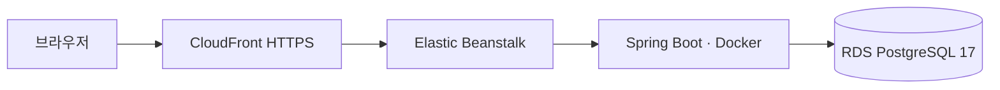

# AWS 배포 구성

## 구성

- React production build는 Spring Boot JAR에 포함됩니다.
- API와 Worker는 같은 애플리케이션 인스턴스에서 실행됩니다.
- 애플리케이션과 DB는 별도 AWS 리소스로 구성했습니다.
- main GitHub Actions가 검증을 수행하고 OIDC로 인증해 기존 Elastic Beanstalk 환경에 배포합니다.
- 데모는 CloudFront HTTPS 주소로 제공합니다: [운영 데모](https://d2cpqpf162fsls.cloudfront.net).
