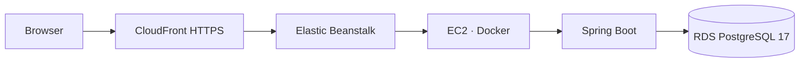

# AWS 배포 구성

## Architecture

## 배포 방식

React production build 결과는 Spring Boot JAR에 포함됩니다. 애플리케이션은 Java 21 runtime Docker image에서 실행되며, API와 Integration Worker는 단일 애플리케이션 인스턴스에서 함께 동작합니다. 애플리케이션과 RDS를 별도 리소스로 구성해 애플리케이션 배포와 DB 생명주기를 분리했습니다. DB 스키마는 Flyway로 관리합니다.

## CI/CD

`local`과 `develop` 브랜치에서는 GitHub Actions가 테스트와 build를 수행합니다. `main` push에서는 같은 검증에 더해 bundle을 만들고, GitHub Actions OIDC로 AWS에 인증해 Elastic Beanstalk Application Version을 생성한 뒤 기존 Elastic Beanstalk 환경에 배포합니다. 검증 job의 artifact를 배포 job으로 전달하고 SHA-256을 비교해 검증한 bundle과 배포 bundle이 같은지 확인합니다.

## 배포 환경

| 항목 | 구성 |
|---|---|
| Runtime | Java 21 / Docker |
| Application | Elastic Beanstalk Single Instance |
| Database | RDS PostgreSQL 17 |
| HTTPS | CloudFront |
